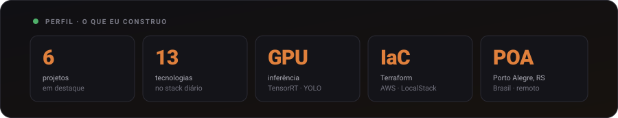
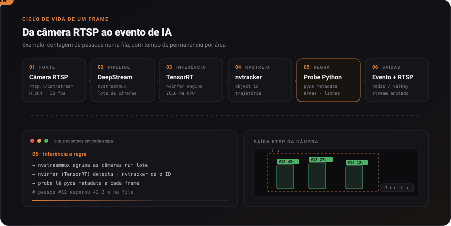

  <b>
  <a href="#sobre">Sobre</a> ·
  <a href="#stack">Stack</a> ·
  <a href="#como-eu-trabalho">Como eu trabalho</a> ·
  <a href="#github">GitHub</a> ·
  <a href="#projetos">Projetos</a> ·
  <a href="#contato">Contato</a>
  </b>

  
  
  
  
  

Computer Vision Developer na **NexAI**, em Porto Alegre. Construo pipelines de vídeo em tempo real com **NVIDIA DeepStream**: a câmera RTSP entra, a inferência roda na **GPU com TensorRT**, a regra de negócio é aplicada frame a frame e sai **evento + stream anotado**. Fora da engine, empacoto e provisiono tudo com **Docker**, **Terraform** e **AWS**.

## Sobre

- 🎥 &nbsp;Pipelines de vídeo com **DeepStream**, **TensorRT**, **YOLO** e **pyds**
- ☁️ &nbsp;Infraestrutura como código com **Terraform** e **AWS** — em busca da primeira certificação
- 🎓 &nbsp;Ciência da Computação na **UniRitter**
- 🌱 &nbsp;Estudando **Kubernetes** e orquestração de workloads de IA

## Stack

  
  
  &nbsp;
  

## Como eu trabalho

Um frame percorre seis etapas, da câmera ao evento. A animação acompanha um frame numa regra de **contagem de fila**; os componentes mostrados em cada etapa são os que a pipeline executa de verdade.

## GitHub

  
  

  
  

  

  <picture>
    <source media="(prefers-color-scheme: dark)" srcset="https://raw.githubusercontent.com/diogenesOliver/diogenesOliver/output/github-contribution-grid-snake-dark.svg"/>
    
  </picture>

## Projetos

- **[yolo-ai](https://github.com/diogenesOliver/yolo-ai)** — detecção de objetos com o modelo YOLO
- **[TicketHUB](https://github.com/diogenesOliver/TicketHUB)** — infraestrutura AWS com LocalStack como provider local
- **[IAC-cdktf](https://github.com/diogenesOliver/IAC-cdktf)** — provisionamento de EC2 na AWS via CDKTF com Python
- **[infra-localstack](https://github.com/diogenesOliver/infra-localstack)** — infraestrutura AWS com Terraform e LocalStack
- **[devops-go](https://github.com/diogenesOliver/devops-go)** — conceitos de DevOps aplicados a uma aplicação Go
- **[PollsAPI-NLW](https://github.com/diogenesOliver/PollsAPI-NLW)** — API de enquetes em tempo real com WebSocket e Redis

## Contato

  
  

